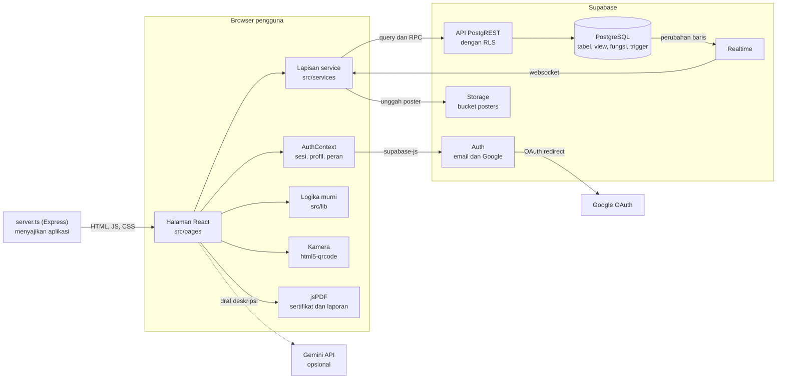
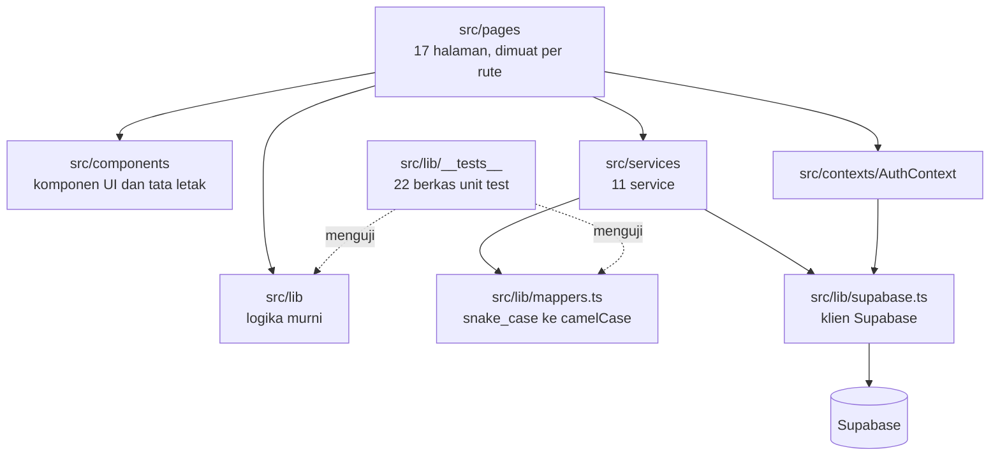
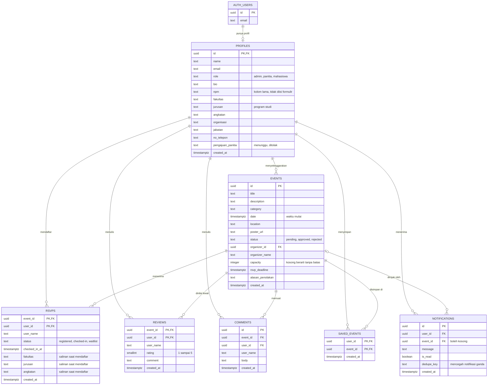
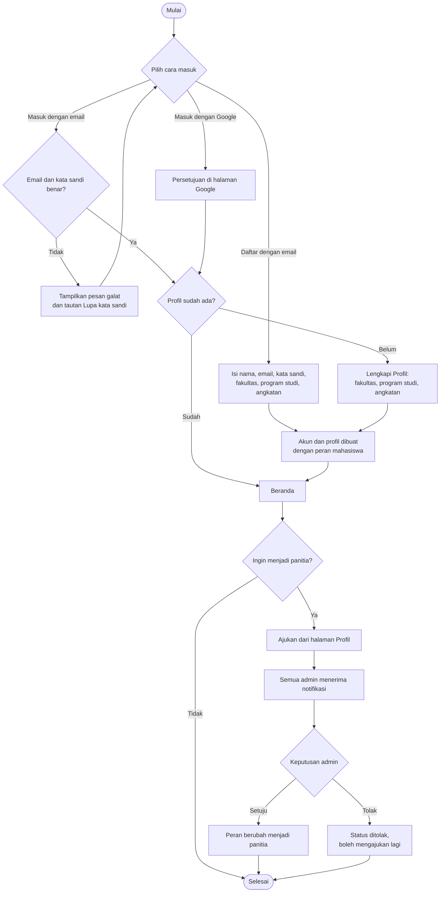
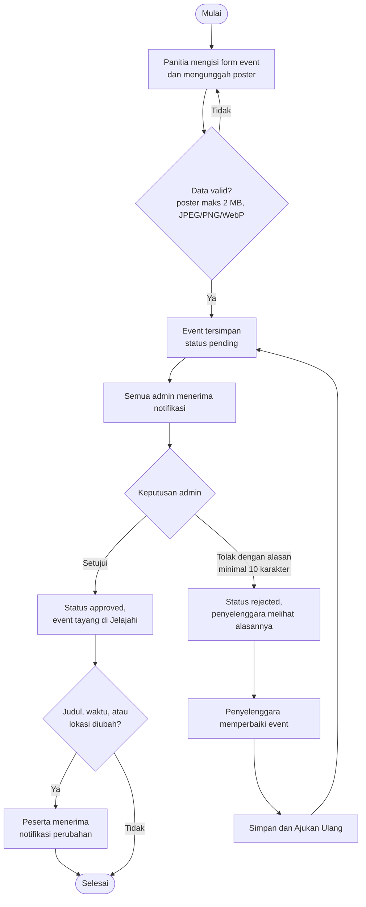
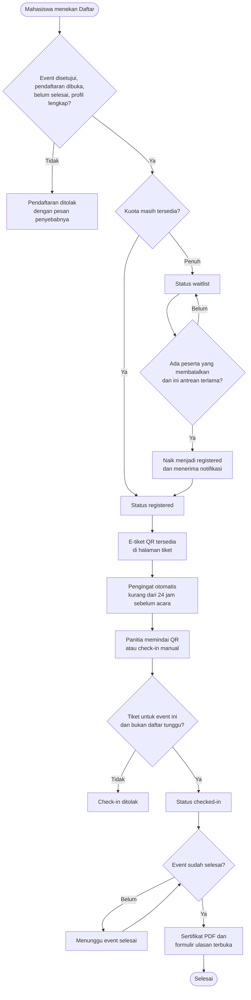
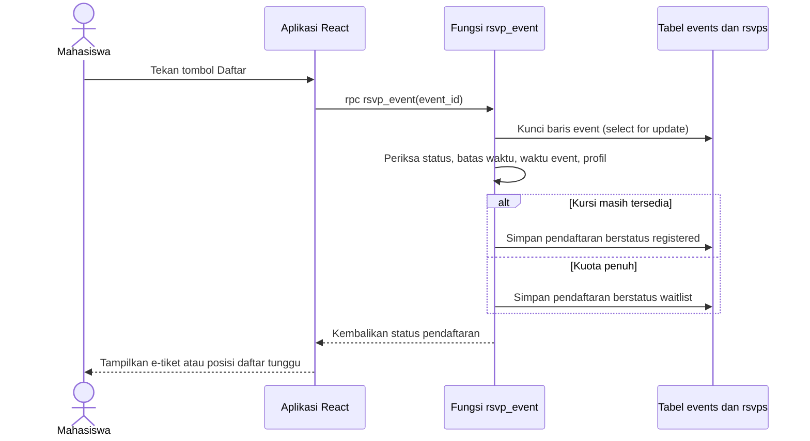

# Arsitektur Sistem KampusHub

**KampusHub: Platform Event Kampus**
Versi 1.0, 15 September 2026

Dokumen ini menggantikan `diagrams.md` dan `diagrams11.md`, yang masih menggambarkan versi
Firebase. Semua diagram ditulis dengan Mermaid, sehingga tampil langsung di GitHub dan bisa
disalin ke [mermaid.live](https://mermaid.live).

---

## 1. Gambaran Arsitektur

Penjelasan:

- **Penyajian aplikasi.** Pada mode pengembangan, `server.ts` menjalankan Vite sebagai
  middleware. Pada mode produksi, `server.ts` menyajikan folder `dist`. Hosting statis seperti
  Netlify juga bisa dipakai karena `public/_redirects` sudah tersedia.
- **Akses data.** Browser memakai anon key lewat supabase-js. Hak akses yang sebenarnya
  ditentukan Row Level Security di database, jadi mengubah kode di browser tidak membuka data
  milik orang lain.
- **Operasi atomik.** Pendaftaran, pembatalan, check-in, moderasi, dan perubahan peran
  dijalankan sebagai fungsi PL/pgSQL yang dipanggil lewat RPC. Semua pemeriksaan dan penulisan
  terjadi dalam satu transaksi.
- **Notifikasi.** Notifikasi dibuat oleh trigger database, lalu dikirim ke browser penerima
  lewat Realtime. Tanya jawab dan ulasan juga diperbarui lewat Realtime.
- **Poster.** Poster disimpan di Supabase Storage, bucket `posters` (maksimal 2 MB, JPEG, PNG,
  atau WebP), di folder milik akun pengunggah.
- **AI.** Draf deskripsi event memanggil Gemini langsung dari browser dan hanya aktif jika
  `GEMINI_API_KEY` diisi. Saat ini kunci tersebut tidak diisi.

---

## 2. Lapisan Kode

| Folder | Isi |
|---|---|
| `src/pages` | Halaman aplikasi. Setiap halaman dimuat hanya saat rutenya dibuka. |
| `src/components` | Komponen UI (tombol, input, modal) dan tata letak (sidebar, navigasi bawah). |
| `src/contexts` | `AuthContext`: sesi, profil, dan peran pengguna yang sedang masuk. |
| `src/services` | Lapisan utama yang berbicara dengan Supabase. Halaman tidak menulis query sendiri. |
| `src/lib` | Logika murni tanpa jaringan: fase event, analitik, sertifikat, rekomendasi, validasi poster, konversi waktu, dan pemetaan kolom. |
| `src/lib/__tests__` | Unit test Vitest untuk logika di `src/lib`. |
| `supabase/migrations` | Skema, view, fungsi, RLS, data demo, fitur lanjutan, dan program studi. Dijalankan berurutan. |

---

## 3. Entity Relationship Diagram

**Penjelasan relasi**

- **1 akun : 0 atau 1 profil.** Baris profil sengaja tidak dibuat otomatis. Akun tanpa profil
  diarahkan ke halaman Lengkapi Profil.
- **1 profil : N event.** Satu panitia bisa menyelenggarakan banyak event, dan setiap event
  punya satu penyelenggara.
- **Profil dan event : N pendaftaran.** Kunci utama `(event_id, user_id)` menjamin satu
  mahasiswa hanya punya satu pendaftaran di setiap event. Aturan yang sama berlaku untuk
  `reviews` dan `saved_events`.
- **Salinan data pendaftar.** Fakultas, program studi, dan angkatan disalin ke `rsvps` saat
  mendaftar, supaya angka analitik tidak berubah jika profil disunting belakangan.
- **Notifikasi tanpa event.** `event_id` di `notifications` boleh kosong, misalnya untuk
  keputusan pengajuan panitia.
- **Penghapusan berantai.** Semua tabel turunan memakai `on delete cascade`. Menghapus event
  ikut menghapus pendaftaran, ulasan, komentar, simpanan, dan notifikasinya.
- **View `events_with_counts`.** Jumlah peserta, daftar tunggu, dan rating tidak disimpan
  sebagai kolom, tetapi dihitung view ini dari tabel `rsvps` dan `reviews`.

---

## 4. Fungsi dan Trigger Database

**Fungsi yang dipanggil aplikasi**

| Fungsi | Dipanggil oleh | Aturan yang ditegakkan |
|---|---|---|
| `rsvp_event` | Mahasiswa | Event disetujui, pendaftaran belum ditutup, event belum selesai, profil lengkap. Jika kuota penuh, pendaftar masuk daftar tunggu. |
| `cancel_rsvp` | Mahasiswa | Menghapus pendaftaran, menaikkan peserta daftar tunggu terlama, lalu mengabarinya. |
| `check_in_rsvp` | Panitia, admin | Tiket harus untuk event yang sedang dipindai, dan peserta bukan daftar tunggu. |
| `putuskan_event` | Admin | Hanya event yang belum diputuskan. Penolakan wajib disertai alasan minimal 10 karakter. |
| `ajukan_ulang_event` | Penyelenggara | Hanya event berstatus ditolak, dan hanya oleh penyelenggaranya. |
| `putuskan_panitia` | Admin | Pengguna harus sedang mengajukan diri sebagai panitia. |
| `ubah_peran` | Admin | Admin tidak boleh menurunkan perannya sendiri. |
| `campus_analytics` | Admin | Hanya admin yang boleh membuka ringkasan kampus. |

**Trigger penjaga**

| Trigger | Fungsi |
|---|---|
| `jaga_role_profil` | Peran dan status pengajuan panitia hanya bisa diubah admin. |
| `jaga_kolom_event` | Status event dan penyelenggara tidak bisa diubah lewat penyuntingan biasa. |

**Trigger notifikasi**

| Trigger | Terjadi saat | Penerima |
|---|---|---|
| `notif_pendaftar_baru` | Ada pendaftar baru | Penyelenggara |
| `notif_komentar_baru` | Ada tulisan baru di tanya jawab | Penyelenggara |
| `notif_event_diajukan` | Event baru diajukan | Semua admin |
| `notif_event_berubah` | Judul, waktu, atau lokasi event yang sudah tayang berubah | Peserta event |
| `notif_event_dihapus` | Event dihapus | Peserta event |
| `notif_pengajuan_panitia` | Ada pengajuan panitia baru | Semua admin |

---

## 5. Flowchart

### 5.1 Pendaftaran Akun dan Masuk

### 5.2 Pengajuan dan Moderasi Event

### 5.3 Pendaftaran Event, Check-in, dan Sertifikat

### 5.4 Urutan Proses Pendaftaran di Server

Karena baris event dikunci sampai transaksi selesai, dua mahasiswa yang menekan Daftar pada
saat bersamaan diproses bergantian. Kursi terakhir tidak mungkin terisi dua kali.

---

## 6. Keputusan Arsitektur

1. **PostgreSQL menggantikan Firestore.** Tiga keterbatasan versi lama berasal dari model
   datanya: jumlah peserta disimpan sebagai kolom yang bisa digeser klien, ringkasan kampus
   harus mengunduh seluruh data pendaftaran, dan pendaftaran ditulis ganda ke dua koleksi.
   Ketiganya hilang di PostgreSQL. Rinciannya ada di README bagian Catatan Arsitektur.
2. **Aturan penting ditegakkan di server.** Fungsi `security definer` memeriksa kewenangan
   pemanggil di dalam fungsi. Trigger penjaga mencegah perubahan peran dan status event lewat
   penyuntingan biasa, sehingga tombol yang disembunyikan di antarmuka bukan satu-satunya
   pengaman.
3. **Kode tiket `{eventId}_{userId}`.** Kode yang sama dipakai sebagai isi QR e-tiket dan
   sebagai kode sertifikat, sehingga scanner dan halaman verifikasi tidak membutuhkan tabel
   tambahan.
4. **Waktu disimpan sebagai `timestamptz`.** Input tanggal di form tidak membawa zona waktu,
   jadi dikonversi dari WIB di `src/lib/waktu-lokal.ts` sebelum disimpan.
5. **Durasi event tetap 4 jam.** Nilai `event_duration()` di database dan `EVENT_DURATION_MS`
   di `src/lib/event-phase.ts` harus selalu sama, karena keduanya menentukan kapan event
   dianggap selesai.

---

## 7. Batasan yang Diketahui

| Batasan | Rencana |
|---|---|
| `check_in_rsvp` meloloskan semua akun panitia, bukan hanya penyelenggara event itu | Perketat pemeriksaan kewenangan di fungsi |
| Kunci Gemini ikut masuk ke kode browser jika diisi | Biarkan kosong, atau pindahkan pemanggilan ke `server.ts` |
| Waktu selesai event tidak disimpan | Dijelaskan sebagai batasan; kolom waktu selesai ditambahkan bila diperlukan |
