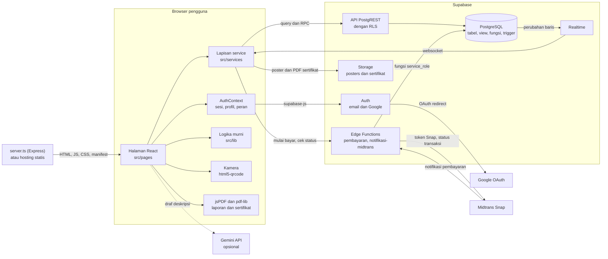
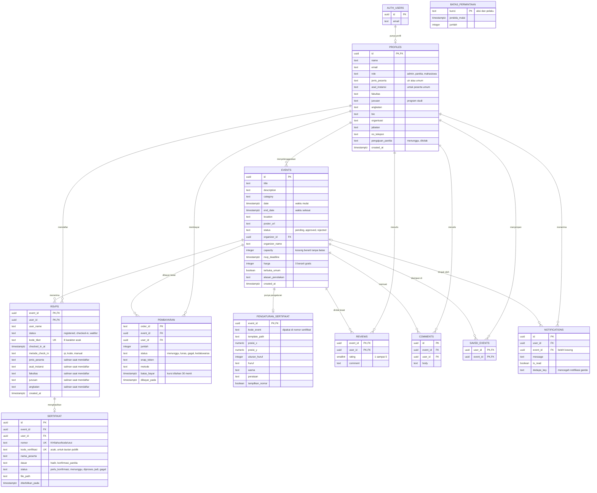
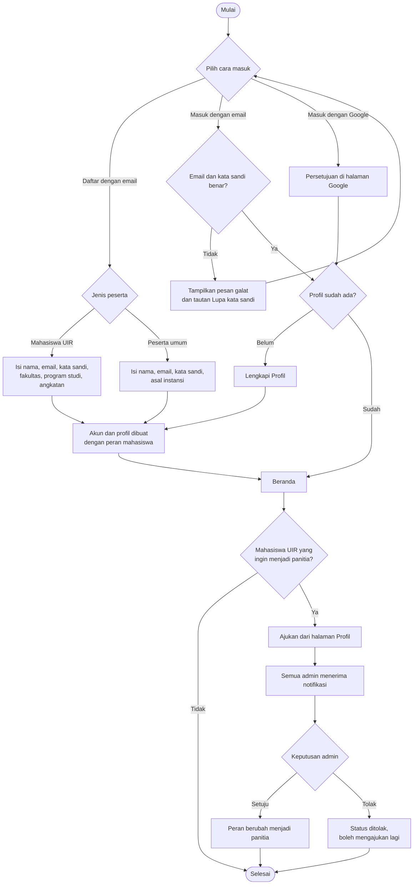
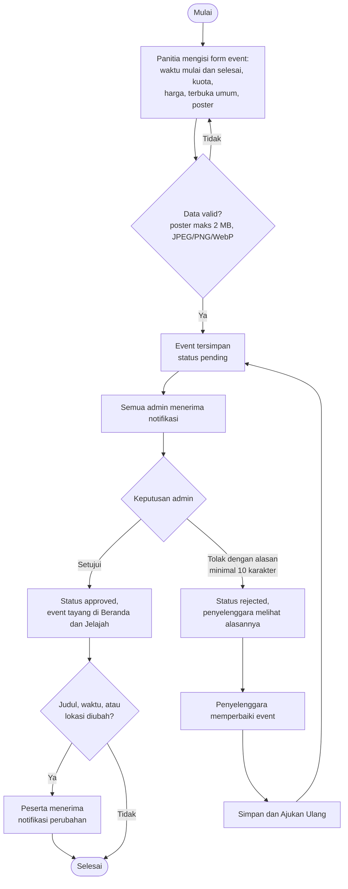
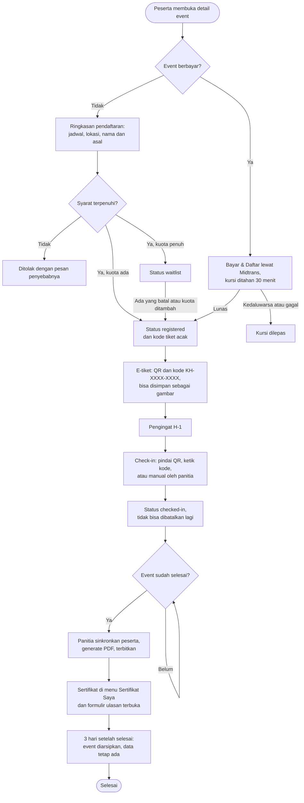
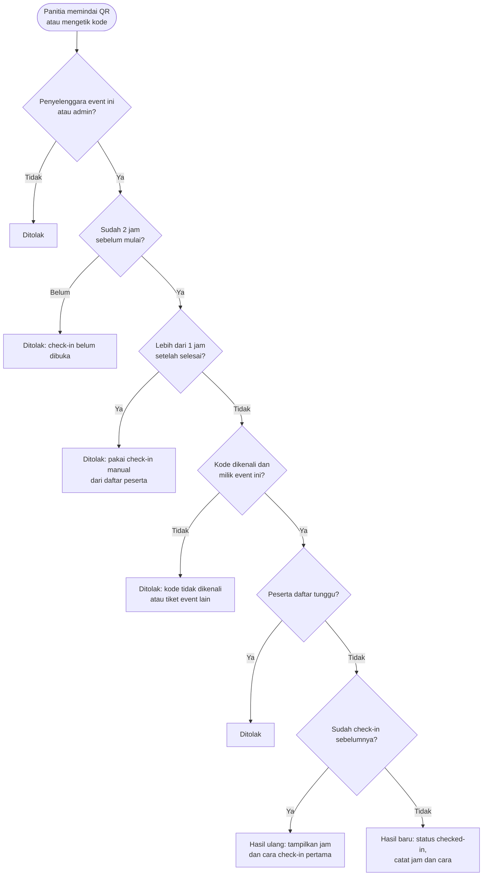
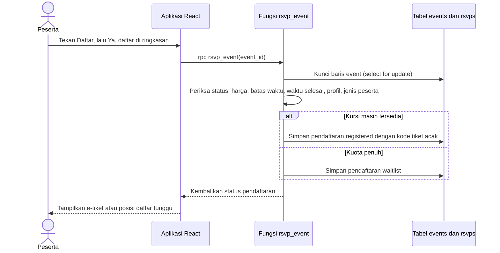
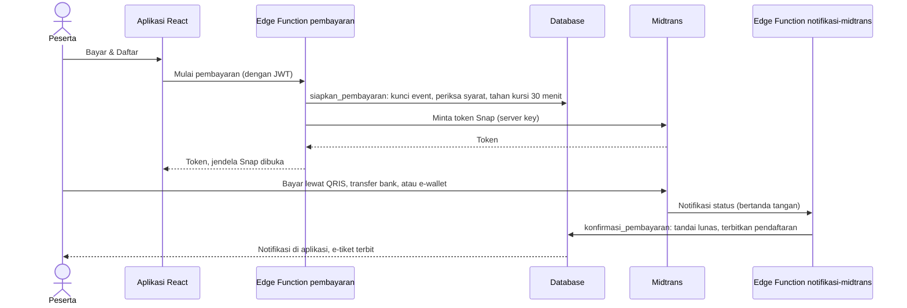

# Arsitektur Sistem KampusHub

**KampusHub: Platform Event Kampus**
Versi 1.1, 28 September 2026

Dokumen ini menggantikan `diagrams.md` dan `diagrams11.md`, yang masih menggambarkan versi
Firebase. Semua diagram ditulis dengan Mermaid, sehingga tampil langsung di GitHub dan bisa
disalin ke [mermaid.live](https://mermaid.live).

Perubahan dari versi 1.0 (migrasi 08 sampai 14): waktu selesai event, peserta dari luar UIR,
event berbayar lewat Midtrans, pembatas permintaan, sistem sertifikat, kode tiket acak dan
jendela check-in, arsip otomatis, serta pemasangan aplikasi di layar utama HP.

---

## 1. Gambaran Arsitektur

Penjelasan:

- **Penyajian aplikasi.** Pada mode pengembangan, `server.ts` menjalankan Vite sebagai
  middleware. Pada mode produksi, `server.ts` menyajikan folder `dist`. Hosting statis seperti
  Netlify juga bisa dipakai karena `public/_redirects` sudah tersedia.
- **Akses data.** Browser memakai anon key lewat supabase-js. Hak akses yang sebenarnya
  ditentukan Row Level Security di database, jadi mengubah kode di browser tidak membuka data
  milik orang lain.
- **Operasi atomik.** Pendaftaran, pembatalan, check-in, moderasi, pembayaran, sertifikat, dan
  perubahan peran dijalankan sebagai fungsi PL/pgSQL. Semua pemeriksaan dan penulisan terjadi
  dalam satu transaksi.
- **Pembayaran.** Server key Midtrans hanya ada di Secrets Edge Function. Edge Function
  `pembayaran` memanggil fungsi database yang menahan kursi, lalu meminta token Snap.
  `notifikasi-midtrans` memeriksa tanda tangan notifikasi Midtrans sebelum menandai lunas.
  Nominal selalu diambil dari kolom `harga` di database, tidak pernah dari browser.
- **Notifikasi.** Notifikasi dibuat oleh trigger dan fungsi database, lalu dikirim ke browser
  penerima lewat Realtime. Tanya jawab dan ulasan juga diperbarui lewat Realtime.
- **Berkas.** Poster disimpan di bucket `posters` (maksimal 2 MB, JPEG, PNG, atau WebP).
  Template dan PDF sertifikat disimpan di bucket privat `sertifikat` (maksimal 10 MB, PDF),
  di folder milik event.
- **Pasang di HP.** `public/manifest.webmanifest` dan ikonnya membuat aplikasi bisa dipasang
  lewat "Tambahkan ke Layar Utama" dan terbuka tanpa bilah alamat. Belum ada service worker,
  jadi aplikasi tetap butuh internet.
- **AI.** Draf deskripsi event memanggil Gemini langsung dari browser dan hanya aktif jika
  `GEMINI_API_KEY` diisi. Saat ini kunci tersebut tidak diisi.

---

## 2. Lapisan Kode

| Folder | Isi |
|---|---|
| `src/pages` | Halaman aplikasi. Setiap halaman dimuat hanya saat rutenya dibuka. |
| `src/components` | Komponen UI (tombol, input, modal, panel bawah) dan tata letak (header, sidebar, navigasi bawah). |
| `src/contexts` | `AuthContext`: sesi, profil, dan peran pengguna yang sedang masuk. |
| `src/services` | Lapisan utama yang berbicara dengan Supabase. Halaman tidak menulis query sendiri. |
| `src/lib` | Logika murni tanpa jaringan: fase event, jendela check-in, kode tiket, arsip, analitik, sertifikat, pembayaran, rekomendasi, validasi poster, konversi waktu, dan pemetaan kolom. |
| `src/lib/__tests__` | Unit test Vitest untuk logika di `src/lib`. |
| `supabase/migrations` | Skema, view, fungsi, RLS, data demo, dan fitur tambahan. Dijalankan berurutan dari 01 sampai 14. |
| `supabase/functions` | Edge Function `pembayaran` dan `notifikasi-midtrans`. |
| `supabase/tests/uji_akses.sql` | Skrip uji hak akses dan aturan bisnis langsung di database. |
| `docs/desain-ui` | Papan desain HTML semua layar ponsel dan desktop, untuk diubah ke Figma. |

---

## 3. Entity Relationship Diagram

**Penjelasan relasi**

- **1 akun : 0 atau 1 profil.** Baris profil sengaja tidak dibuat otomatis. Akun tanpa profil
  diarahkan ke halaman Lengkapi Profil.
- **Peran dan asal dipisah.** `role` menentukan hak akses. `jenis_peserta` menyimpan asal orangnya
  (mahasiswa UIR atau peserta umum), jadi peserta umum tetap berperan `mahasiswa` dan semua policy
  lama tidak perlu diubah.
- **Profil dan event : N pendaftaran.** Kunci utama `(event_id, user_id)` menjamin satu akun hanya
  punya satu pendaftaran di setiap event. Aturan yang sama berlaku untuk `reviews` dan
  `saved_events`.
- **Kode tiket.** Setiap pendaftaran punya `kode_tiket` unik yang dibuat database. Kode ini isi QR
  e-tiket dan juga bisa diketik panitia.
- **Salinan data pendaftar.** Jenis peserta, asal instansi, fakultas, program studi, dan angkatan
  disalin ke `rsvps` saat mendaftar, supaya laporan event lama tidak berubah jika profil disunting.
- **Pembayaran.** Satu peserta hanya boleh punya satu transaksi aktif (menunggu atau lunas) per
  event. Transaksi dibuat dan diubah hanya oleh fungsi yang dipanggil Edge Function.
- **Sertifikat merujuk pendaftaran.** `sertifikat` punya foreign key ke `rsvps`, jadi tidak ada
  daftar peserta kedua. Pendaftaran yang dihapus ikut menghapus sertifikatnya.
- **Penghapusan berantai.** Tabel turunan memakai `on delete cascade`. Karena itu event berbayar
  yang punya pembayaran lunas dijaga trigger dan tidak bisa dihapus, dan aplikasi menyembunyikan
  tombol hapus untuk event selesai yang punya peserta.
- **View `events_with_counts`.** Jumlah peserta, daftar tunggu, kursi yang sedang ditahan, dan
  rating tidak disimpan sebagai kolom, tetapi dihitung view ini.

---

## 4. Fungsi dan Trigger Database

**Fungsi yang dipanggil aplikasi**

| Fungsi | Dipanggil oleh | Aturan yang ditegakkan |
|---|---|---|
| `rsvp_event` | Peserta | Event gratis, disetujui, pendaftaran belum ditutup, event belum selesai, profil lengkap. Peserta umum hanya untuk event terbuka umum. Jika kuota penuh, masuk daftar tunggu. |
| `cancel_rsvp` | Peserta | Ditolak untuk event berbayar, event yang sudah selesai, dan peserta yang sudah check-in. Setelah batal, peserta daftar tunggu terlama naik dan dikabari. |
| `check_in_rsvp` | Penyelenggara, admin | Hanya penyelenggara event itu atau admin. Dibuka 2 jam sebelum mulai, ditutup 1 jam setelah selesai. Kode tiket harus milik event ini dan bukan daftar tunggu. Pindai ulang dilaporkan bersama jam dan cara check-in pertama. |
| `check_in_manual` | Penyelenggara, admin | Sama seperti di atas, tetapi tetap bisa dipakai setelah pindai ditutup. |
| `normalisasi_kode_tiket` | Aplikasi | Mengubah `kh-7f3k-9q2m` atau `KH7F3K9Q2M` menjadi kode baku. |
| `verifikasi_sertifikat` | Siapa saja, tanpa login | Hanya mengembalikan data yang tercetak di sertifikat. Dibatasi 30 permintaan per menit per IP. |
| `ringkasan_sertifikat`, `simpan_pengaturan_sertifikat`, `sinkronkan_peserta_sertifikat`, `setujui_sertifikat`, `ambil_antrean_sertifikat`, `catat_hasil_sertifikat`, `ulangi_sertifikat_gagal`, `buat_ulang_sertifikat`, `terbitkan_sertifikat`, `terbitkan_ulang_sertifikat` | Penyelenggara, admin | Alur sertifikat per event. Nomor sertifikat dibagikan database di bawah kunci baris event, sehingga tidak ada nomor ganda. |
| `siapkan_pembayaran`, `simpan_token_pembayaran`, `konfirmasi_pembayaran` | Edge Function (service_role) | Menahan kursi 30 menit, menyimpan token Snap, lalu menandai lunas dan menerbitkan pendaftaran. Tidak bisa dipanggil dari browser. |
| `putuskan_event` | Admin | Hanya event yang belum diputuskan. Penolakan wajib disertai alasan minimal 10 karakter. |
| `ajukan_ulang_event` | Penyelenggara | Hanya event berstatus ditolak, dan hanya oleh penyelenggaranya. |
| `putuskan_panitia` | Admin | Pengguna harus sedang mengajukan diri, dan hanya mahasiswa UIR yang boleh jadi panitia. |
| `ubah_peran` | Admin | Admin tidak boleh menurunkan perannya sendiri. |
| `campus_analytics` | Admin | Hanya admin yang boleh membuka ringkasan kampus. |

**Trigger penjaga**

| Trigger | Fungsi |
|---|---|
| `jaga_role_profil` | Peran dan status pengajuan panitia hanya bisa diubah admin. |
| `jaga_kolom_event` | Status event dan penyelenggara tidak bisa diubah lewat penyuntingan biasa. |
| `jaga_waktu_selesai` | Waktu selesai harus setelah waktu mulai; kalau kosong diisi mulai + 4 jam. |
| `jaga_harga_event` | Harga terkunci setelah ada peserta yang membayar. |
| `jaga_hapus_event_berbayar` | Event yang punya pembayaran lunas tidak bisa dihapus. |
| `naikkan_daftar_tunggu` | Saat kuota dinaikkan, peserta daftar tunggu naik sesuai kursi yang bertambah. |
| `batasi_pendaftaran_event`, `batasi_pembatalan_event`, `batasi_tanya_jawab`, `batasi_transaksi_pembayaran`, `batasi_pengajuan_panitia` | Pembatas permintaan: 10 daftar atau batal per menit, 5 pertanyaan per menit, 5 transaksi per 10 menit, 3 pengajuan panitia per jam. |

**Trigger notifikasi**

| Trigger | Terjadi saat | Penerima |
|---|---|---|
| `notif_pendaftar_baru` | Ada pendaftar baru | Penyelenggara |
| `notif_komentar_baru` | Ada tulisan baru di tanya jawab | Penyelenggara |
| `notif_event_diajukan` | Event baru diajukan | Semua admin |
| `notif_event_berubah` | Judul, waktu, atau lokasi event yang sudah tayang berubah | Peserta event |
| `notif_event_dihapus` | Event dihapus | Peserta event |
| `notif_pengajuan_panitia` | Ada pengajuan panitia baru | Semua admin |

Notifikasi lain dikirim dari dalam fungsi: naik dari daftar tunggu, pembayaran lunas, dan
sertifikat terbit.

---

## 5. Flowchart

### 5.1 Pendaftaran Akun dan Masuk

### 5.2 Pengajuan dan Moderasi Event

### 5.3 Pendaftaran Event sampai Sertifikat

### 5.4 Aturan Check-in di Server

### 5.5 Urutan Proses Pendaftaran di Server

Karena baris event dikunci sampai transaksi selesai, dua peserta yang menekan Daftar pada saat
bersamaan diproses bergantian. Kursi terakhir tidak mungkin terisi dua kali. Hal yang sama
berlaku untuk kursi yang ditahan selama pembayaran.

### 5.6 Urutan Proses Pembayaran

Kalau notifikasi Midtrans tidak sampai, tombol Cek Status Pembayaran di aplikasi meminta Edge
Function memeriksa status ke Midtrans dan berakhir di fungsi yang sama.

---

## 6. Keputusan Arsitektur

1. **PostgreSQL menggantikan Firestore.** Tiga keterbatasan versi lama berasal dari model
   datanya: jumlah peserta disimpan sebagai kolom yang bisa digeser klien, ringkasan kampus
   harus mengunduh seluruh data pendaftaran, dan pendaftaran ditulis ganda ke dua koleksi.
   Ketiganya hilang di PostgreSQL. Rinciannya ada di README bagian Catatan Arsitektur.
2. **Aturan penting ditegakkan di server.** Fungsi `security definer` memeriksa kewenangan
   pemanggil di dalam fungsi. Trigger penjaga mencegah perubahan peran, status, dan harga event
   lewat penyuntingan biasa, sehingga tombol yang disembunyikan di antarmuka bukan
   satu-satunya pengaman. `supabase/tests/uji_akses.sql` menguji aturan ini langsung di database.
3. **Kode tiket acak.** Dulu isi QR adalah `{eventId}_{userId}`, yang bisa dibuat sendiri oleh
   orang lain karena kedua id itu terlihat di aplikasi. Sekarang setiap pendaftaran punya kode
   8 karakter acak dari pembangkit kriptografis, tanpa huruf yang mudah tertukar (0, 1, I, L,
   O), dan dicetak sebagai `KH-7F3K-9Q2M`. Kode verifikasi sertifikat juga acak, bukan nomor
   urut, supaya sertifikat orang lain tidak bisa ditebak lewat URL.
4. **Waktu disimpan sebagai `timestamptz`.** Input tanggal di form tidak membawa zona waktu,
   jadi dikonversi dari WIB di `src/lib/waktu-lokal.ts` sebelum disimpan.
5. **Waktu selesai disimpan.** Kolom `end_date` menentukan kapan event dianggap selesai.
   Durasi 4 jam (`event_duration()` di database dan `EVENT_DURATION_MS` di
   `src/lib/event-phase.ts`) hanya dipakai kalau waktu selesai kosong, dan keduanya harus sama.
6. **Jendela check-in ditulis di dua tempat.** Angka 2 jam sebelum mulai dan 1 jam setelah
   selesai ada di fungsi check-in dan di `src/lib/check-in.ts`. Database yang menegakkan
   aturannya; aplikasi memakainya untuk menampilkan kapan kamera menyala.
7. **Arsip dihitung, bukan disimpan.** Event dianggap diarsipkan sejak 3 hari setelah selesai
   (`src/lib/arsip.ts`). Tidak ada kolom atau proses terjadwal: daftar event cukup menyaring
   `end_date`, jadi pendaftaran, kehadiran, dan sertifikatnya tetap ada.
8. **Sertifikat dibuat di browser panitia.** PDF disusun dengan pdf-lib dari template panitia.
   Database hanya membagikan antrean sedikit demi sedikit dan mencatat hasilnya, sehingga tidak
   butuh server tambahan. Kalau tab tertutup di tengah jalan, proses bisa dilanjutkan.
9. **Rahasia pembayaran hanya di server.** Server key Midtrans disimpan di Secrets Edge Function,
   dan fungsi pembayaran di database hanya bisa dipanggil `service_role`.

---

## 7. Batasan yang Diketahui

| Batasan | Rencana |
|---|---|
| Belum ada service worker, jadi aplikasi dan scanner butuh internet | E-tiket bisa disimpan sebagai gambar untuk ditunjukkan saat sinyal buruk; mode luring bisa ditambahkan dengan service worker |
| Notifikasi hanya di dalam aplikasi, belum lewat email | Pasang Custom SMTP di Supabase lalu tambahkan pengiriman email |
| Pengembalian dana event berbayar belum ada alurnya | Sementara ditangani panitia di luar aplikasi |
| Satu akun hanya bisa memegang satu tiket per event | Cukup untuk event kampus; pembelian banyak tiket butuh tabel tiket terpisah |
| Jendela check-in sama untuk semua event | Jadikan kolom per event kalau ada acara yang butuh aturan berbeda |
| Event yang diarsipkan masih bisa dibuka lewat tautan langsung | Disengaja, supaya riwayat dan verifikasi tetap bisa dibuka; halaman memberi catatan arsip |
| Kunci Gemini ikut masuk ke kode browser jika diisi | Biarkan kosong, atau pindahkan pemanggilan ke Edge Function |
