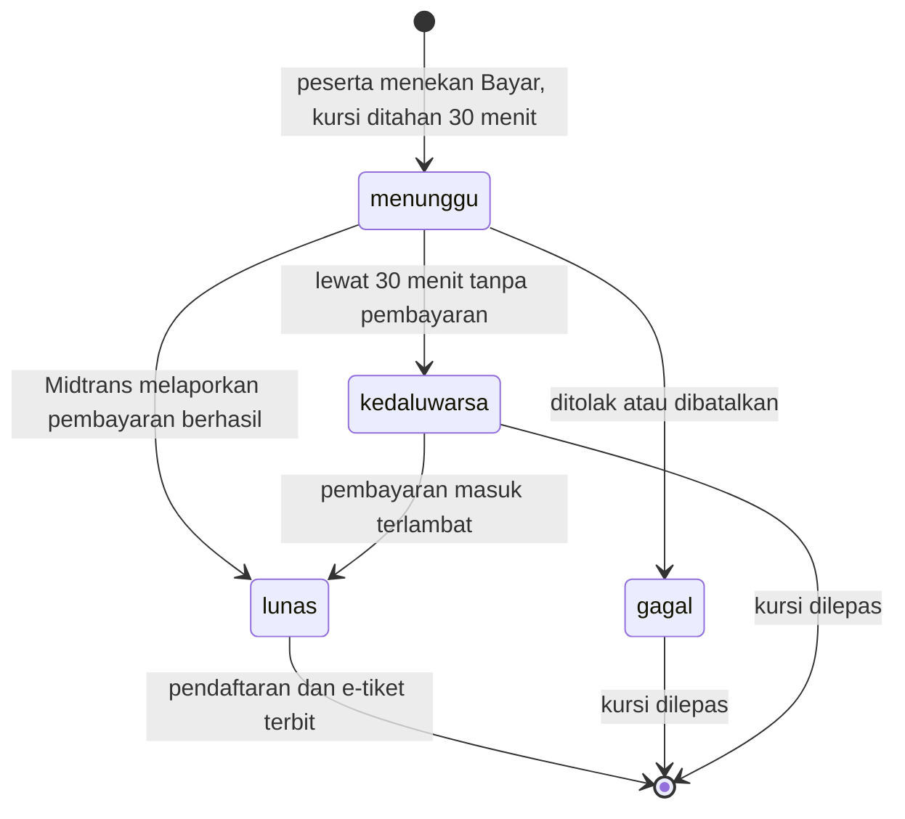

# Project Definition Document

**KampusHub: Platform Event Kampus**
Versi 1.2, 1 Oktober 2026

Perubahan dari versi 1.1: ditambahkan bagian 8, Proses Bisnis dan Keamanan Pembayaran, yang
menjelaskan alur pembayaran, validasi di setiap langkah, ancaman dan pengamannya, serta batasan
yang masih ada beserta rencana penguatannya.

Perubahan dari versi 1.0: scope bertambah dengan event berbayar lewat Midtrans, peserta dari luar
UIR, sistem sertifikat massal, kode tiket acak dan jendela check-in, arsip otomatis, serta
pemasangan aplikasi di layar utama HP. Waktu selesai event kini disimpan, dan check-in hanya boleh
dilakukan penyelenggara event itu atau admin. Penambahan scope ini perlu dilaporkan ke dosen
(lihat risiko nomor 6).

---

## 1. Identitas Project dan Anggota

| | |
|---|---|
| Nama project | KampusHub: Platform Event Kampus |
| Jenis project | Web App |
| Mata kuliah | Project Capstone |
| Program studi | Teknik Informatika, Fakultas Teknik, Universitas Islam Riau |
| Dosen pengampu | _(diisi kelompok)_ |
| Nomor kelompok | _(diisi kelompok)_ |
| Repository | https://github.com/RifqiPermanaPutra/KampusHub |

| No | Peran | Nama | NPM | Tanggung jawab |
|---|---|---|---|---|
| 1 | Koordinator | _(diisi)_ | _(diisi)_ | Progress, backlog, komunikasi dengan dosen |
| 2 | Technical Lead | _(diisi)_ | _(diisi)_ | Arsitektur, integrasi, keputusan teknis |
| 3 | Developer 1 | _(diisi)_ | _(diisi)_ | Implementasi modul utama |
| 4 | Developer 2 | _(diisi)_ | _(diisi)_ | Implementasi modul pendukung |
| 5 | Testing & Docs | _(diisi)_ | _(diisi)_ | Pengujian, integrasi, dokumentasi teknis |

Modul yang dipegang setiap peran ada di bagian 10.

---

## 2. Latar Belakang dan Masalah

Informasi kegiatan kampus seperti seminar, lomba, dan kegiatan organisasi tersebar di grup
WhatsApp, poster di mading, dan akun media sosial masing-masing unit kegiatan. Tidak ada satu
tempat yang bisa diandalkan, sehingga mahasiswa mudah melewatkan kegiatan yang relevan dan
panitia sulit menjangkau peserta.

Pendaftaran umumnya memakai formulir pihak ketiga yang direkap manual. Kuota sulit dijaga,
data pendaftar bisa ganda, dan kehadiran dicatat lewat daftar tanda tangan. Untuk kegiatan
berbayar, bukti transfer dicocokkan satu per satu. Setelah acara, panitia masih harus membuat
sertifikat dan laporan satu per satu.

Dari sisi kampus, admin kemahasiswaan tidak punya satu tempat untuk memeriksa kegiatan yang
membawa nama institusi sebelum dipublikasikan, maupun untuk menentukan siapa yang berhak
menjadi penyelenggara.

**Rumusan masalah**

1. Bagaimana memusatkan informasi event kampus supaya mudah ditemukan mahasiswa dan peserta
   dari luar kampus?
2. Bagaimana panitia bisa membuka pendaftaran gratis maupun berbayar dengan kuota yang terjaga,
   mencatat kehadiran, dan menerbitkan sertifikat tanpa rekap manual?
3. Bagaimana admin kampus bisa memoderasi event dan mengatur siapa yang boleh menjadi panitia?

---

## 3. Pengguna

| Pengguna | Kebutuhan utama |
|---|---|
| Mahasiswa UIR | Menemukan event, mendaftar atau membayar, menyimpan e-tiket, mendapat pengingat dan sertifikat |
| Peserta umum | Siswa, mahasiswa kampus lain, atau masyarakat yang mendaftar ke event yang dibuka untuk umum |
| Panitia | Mengajukan event, mengelola peserta, melakukan check-in, menerbitkan sertifikat, melihat analitik |
| Admin | Menyetujui atau menolak event, mengesahkan panitia, mengatur peran, melihat ringkasan kampus |

Setiap akun baru berperan Mahasiswa. Peserta umum juga berperan Mahasiswa dan dibedakan lewat
jenis peserta, sehingga hak aksesnya sama. Peran Panitia hanya bisa didapat mahasiswa UIR lewat
pengajuan yang disetujui admin.

---

## 4. Tujuan, Solusi, dan Fitur Inti

**Tujuan**

1. Menyediakan satu platform web untuk publikasi event kampus yang sudah dimoderasi.
2. Mengotomatiskan pendaftaran event gratis dan berbayar, termasuk kuota, batas waktu, daftar
   tunggu, dan pembayaran, dengan aturan yang ditegakkan di server.
3. Menggantikan presensi manual dengan e-tiket dan check-in, lalu menerbitkan sertifikat
   bernomor yang bisa diverifikasi.
4. Memberi panitia dan admin data kehadiran, sebaran peserta, dan pendapatan tiket untuk
   evaluasi kegiatan.

**Solusi**

Aplikasi web React yang terhubung ke Supabase (PostgreSQL, Auth, Realtime, Storage, Edge
Functions) dan Midtrans untuk pembayaran. Aturan bisnis yang penting, seperti kuota, batas
waktu, jendela check-in, harga, dan hak akses, ditegakkan di database lewat fungsi
transaksional dan Row Level Security, bukan hanya di browser. Rincian arsitektur ada di
[arsitektur.md](arsitektur.md).

**Fitur inti**

| Kode | Fitur inti | Cakupan |
|---|---|---|
| FI-1 | Akun dan peran | Daftar dengan email atau Google sebagai mahasiswa UIR atau peserta umum, lupa kata sandi, lengkapi profil, pengajuan panitia, pengaturan peran oleh admin |
| FI-2 | Publikasi dan moderasi event | Panitia membuat event dengan waktu mulai dan selesai, kuota, harga, pilihan terbuka untuk umum, dan poster; admin menyetujui atau menolak dengan alasan; panitia memperbaiki lalu mengajukan ulang |
| FI-3 | Pendaftaran dan pembayaran | Ringkasan sebelum mendaftar, kuota, batas waktu, daftar tunggu yang naik otomatis, event berbayar lewat Midtrans dengan kursi ditahan 30 menit, serta aturan pembatalan |
| FI-4 | E-tiket, check-in, dan sertifikat | E-tiket berisi QR dan kode acak yang bisa diketik dan disimpan sebagai gambar; check-in dengan jendela waktu lewat pindai, ketik kode, atau manual; sertifikat dari template PDF panitia yang diterbitkan ke peserta dan bisa diverifikasi tanpa login |
| FI-5 | Notifikasi dan analitik | Notifikasi realtime dari database, pengingat H-1, analitik peserta per event, pendapatan tiket, ekspor CSV, laporan PDF, ringkasan kampus |

Kelima fitur ini saling terhubung: event yang disetujui (FI-2) membuka pendaftaran dan
pembayaran (FI-3), pendaftaran menghasilkan e-tiket yang dipakai untuk check-in dan menentukan
siapa yang berhak atas sertifikat (FI-4), dan setiap langkahnya memicu notifikasi serta mengisi
data analitik (FI-5).

**Fitur pendukung**

Pencarian dan filter event (kategori, fase waktu, dan terbuka untuk umum), simpan event, ulasan
dan rating, tanya jawab per event, rekomendasi di Beranda, Papan Info, tambah ke kalender
(.ics), bagikan event, arsip otomatis 3 hari setelah event selesai, tampilan yang dirancang
untuk HP lebih dulu dengan navigasi bawah, pemasangan di layar utama HP, serta draf deskripsi
event dengan AI Gemini. Fitur AI bersifat opsional dan tidak aktif selama kunci API tidak diisi.

---

## 5. Scope

**In scope**

- Aplikasi web responsif untuk tiga peran: mahasiswa, panitia, dan admin, dengan peserta dari
  luar UIR untuk event yang dibuka untuk umum.
- Satu institusi, memakai daftar 9 fakultas dan 34 program studi Universitas Islam Riau.
- Fitur inti FI-1 sampai FI-5 beserta fitur pendukung di atas.
- Pembayaran event berbayar lewat Midtrans. Demo memakai mode sandbox tanpa uang sungguhan.
- Notifikasi di dalam aplikasi.
- Pemasangan di layar utama HP lewat manifest web, tanpa mode luring.
- Data demo untuk presentasi (`supabase/migrations/05_seed.sql`).

**Out of scope**

- Aplikasi mobile native (Android atau iOS) dan mode luring (service worker).
- Pengembalian dana otomatis. Urusan pengembalian dana ditangani panitia di luar aplikasi.
- Kategori tiket (misalnya VIP dan reguler), pemilihan kursi, dan pembelian banyak tiket dalam
  satu akun.
- Integrasi dengan sistem akademik kampus, termasuk verifikasi NPM.
- Notifikasi lewat email atau WhatsApp kepada peserta. Email hanya dipakai untuk urusan akun,
  yaitu konfirmasi dan atur ulang kata sandi.
- Banyak kampus dalam satu aplikasi.
- Pemesanan ruangan dan pengecekan bentrok jadwal atau lokasi.

---

## 6. Functional Requirement

| Kode | Kebutuhan | Pengguna | Diterapkan di |
|---|---|---|---|
| FR-01 | Sistem harus dapat mendaftarkan akun dengan email dan kata sandi beserta nama dan jenis peserta: mahasiswa UIR (fakultas, program studi, tahun angkatan) atau peserta umum (asal instansi). | Semua | `Register.tsx`, `PilihJenisPeserta.tsx`, Supabase Auth |
| FR-02 | Sistem harus dapat memproses masuk dengan email dan kata sandi maupun dengan akun Google. | Semua | `authService.ts`, Supabase Auth |
| FR-03 | Sistem harus dapat mengirim tautan atur ulang kata sandi ke email pengguna. | Semua | `LupaSandi.tsx`, `AturSandi.tsx` |
| FR-04 | Sistem harus meminta pengguna yang belum punya profil, misalnya pendaftar lewat Google, melengkapi jenis peserta beserta datanya sebelum memakai aplikasi. | Peserta | `CompleteProfile.tsx`, `Guard.tsx` |
| FR-05 | Sistem harus memberi peran Mahasiswa pada setiap akun baru dan menolak perubahan peran yang tidak dilakukan admin. | Semua | policy insert `profiles`, trigger `jaga_role_profil` |
| FR-06 | Sistem harus dapat menerima pengajuan menjadi panitia (organisasi, jabatan, nomor telepon) dari mahasiswa UIR dan meneruskannya ke admin untuk disetujui atau ditolak. | Mahasiswa, Admin | `Profile.tsx`, `putuskan_panitia()` |
| FR-07 | Sistem harus memungkinkan admin mengubah peran pengguna, tetapi menolak admin yang menurunkan perannya sendiri. | Admin | `Dashboard.tsx`, `ubah_peran()` |
| FR-08 | Sistem harus dapat menyimpan event baru (judul, deskripsi, kategori, waktu mulai dan selesai, lokasi, kapasitas, batas pendaftaran, harga, terbuka untuk umum, poster) dengan status Menunggu. | Panitia | `CreateEvent.tsx`, trigger `jaga_waktu_selesai` |
| FR-09 | Sistem harus menolak poster yang lebih besar dari 2 MB atau bukan berformat JPEG, PNG, atau WebP. | Panitia | `poster.ts`, bucket `posters` |
| FR-10 | Sistem harus memungkinkan admin menyetujui atau menolak event, dan penolakan wajib disertai alasan minimal 10 karakter. | Admin | `putuskan_event()` |
| FR-11 | Sistem harus memungkinkan penyelenggara memperbaiki event yang ditolak lalu mengajukannya ulang. | Panitia | `ajukan_ulang_event()` |
| FR-12 | Sistem harus menampilkan hanya event yang disetujui, dengan pencarian teks serta filter kategori, fase waktu, dan terbuka untuk umum. | Peserta | `ExploreEvents.tsx`, policy "baca event disetujui" |
| FR-13 | Sistem harus menampilkan ringkasan pendaftaran sebelum mendaftar, dan menolak pendaftaran jika event belum disetujui, pendaftaran sudah ditutup, event sudah selesai, profil belum lengkap, atau peserta umum mendaftar ke event khusus mahasiswa UIR. | Peserta | `KonfirmasiDaftar.tsx`, `rsvp_event()` |
| FR-14 | Sistem harus memasukkan pendaftar event gratis ke daftar tunggu saat kuota penuh, dan satu akun hanya bisa mendaftar sekali di setiap event. | Peserta | `rsvp_event()`, kunci utama `rsvps` |
| FR-15 | Sistem harus menaikkan peserta daftar tunggu terlama menjadi terdaftar saat ada peserta yang membatalkan atau kuota dinaikkan, lalu mengabarinya. | Peserta | `cancel_rsvp()`, trigger `naikkan_daftar_tunggu` |
| FR-16 | Sistem harus menerbitkan e-tiket berisi QR dan kode acak berformat `KH-XXXX-XXXX`, yang bisa disimpan sebagai gambar, serta menyediakan berkas kalender (.ics). | Peserta | `MyRSVPs.tsx`, `ticket-code.ts`, `tiket-gambar.ts`, `calendar.ts` |
| FR-17 | Sistem harus mencatat kehadiran lewat pindai QR, ketik kode, atau check-in manual; hanya oleh penyelenggara event itu atau admin; mulai 2 jam sebelum acara, dengan pindai dan ketik kode ditutup 1 jam setelah acara selesai; menolak tiket event lain dan peserta daftar tunggu; serta melaporkan pindai ulang beserta jam dan cara check-in pertamanya. | Panitia, Admin | `TicketScanner.tsx`, `check-in.ts`, `check_in_rsvp()`, `check_in_manual()` |
| FR-18 | Sistem harus memungkinkan panitia menyiapkan template sertifikat (unggah PDF atau desain bawaan), membuat sertifikat bernomor untuk peserta yang hadir, menyetujui peserta berbayar yang tidak check-in, lalu menerbitkannya ke menu Sertifikat Saya. Siapa saja dapat memverifikasi keaslian sertifikat tanpa login. | Panitia, Peserta | `SertifikatEvent.tsx`, `SertifikatSaya.tsx`, `VerifyCertificate.tsx`, `sertifikat-pdf.ts`, fungsi `*_sertifikat` |
| FR-19 | Sistem harus menerima satu ulasan (bintang 1 sampai 5) dari setiap peserta yang hadir, setelah event selesai. | Peserta | `review.ts`, policy "peserta hadir menulis ulasan" |
| FR-20 | Sistem harus menyediakan tanya jawab di setiap event yang diperbarui secara realtime. | Semua | `commentService.ts` |
| FR-21 | Sistem harus mengirim notifikasi otomatis: pendaftar dan pertanyaan baru ke penyelenggara, event dan pengajuan panitia baru ke admin, keputusan admin ke pihak yang mengajukan, kenaikan dari daftar tunggu, pembayaran lunas, sertifikat terbit, serta perubahan judul, waktu, lokasi, atau penghapusan event ke peserta. | Semua | trigger `notif_*` dan fungsi moderasi, pembayaran, sertifikat |
| FR-22 | Sistem harus membuat pengingat untuk event yang didaftar atau disimpan jika event dimulai kurang dari 24 jam lagi, tanpa pengingat ganda. | Peserta | `reminder.ts`, kolom `dedupe_key` |
| FR-23 | Sistem harus menampilkan analitik event: jumlah terdaftar, hadir, daftar tunggu, tingkat kehadiran, pendapatan tiket, sebaran fakultas, program studi, angkatan, dan asal peserta umum, serta tren pendaftaran harian. | Panitia, Admin | `EventAnalytics.tsx`, `analytics.ts` |
| FR-24 | Sistem harus dapat mengekspor daftar peserta ke CSV dan laporan event ke PDF. | Panitia, Admin | `EventDetail.tsx`, `event-report.ts` |
| FR-25 | Sistem harus menampilkan ringkasan analitik seluruh kampus hanya kepada admin. | Admin | `campus_analytics()` |
| FR-26 | Sistem harus dapat menyimpan event ke daftar simpanan pengguna. | Peserta | `savedService.ts` |
| FR-27 | Sistem harus menerima pembayaran event berbayar lewat Midtrans (QRIS, transfer bank, e-wallet), menahan kursi selama 30 menit, menerbitkan pendaftaran setelah lunas, dan menampilkan pembayaran yang belum selesai serta bukti bayar di halaman tiket. | Peserta | `PanelBayar.tsx`, `pembayaranService.ts`, Edge Function `pembayaran` dan `notifikasi-midtrans`, `siapkan_pembayaran()`, `konfirmasi_pembayaran()` |
| FR-28 | Sistem harus menolak pembatalan pendaftaran untuk event berbayar yang sudah lunas, event yang sudah selesai, dan peserta yang sudah check-in. | Peserta | `cancel_rsvp()`, `registration.ts` |
| FR-29 | Sistem harus mengunci harga event setelah ada yang membayar, dan menolak penghapusan event yang punya pembayaran lunas atau sudah selesai dengan peserta. | Panitia, Admin | trigger `jaga_harga_event` dan `jaga_hapus_event_berbayar`, `arsip.ts` |
| FR-30 | Sistem harus menyembunyikan event dari Beranda, Jelajah, dan Disimpan 3 hari setelah selesai tanpa menghapus datanya, dan tetap menampilkannya di riwayat tiket peserta serta dasbor panitia. | Semua | `arsip.ts`, `eventService.ts`, `MyRSVPs.tsx`, `Dashboard.tsx` |

---

## 7. Non-Functional Requirement

| Kode | Aspek | Kebutuhan | Cara membuktikan |
|---|---|---|---|
| NFR-01 | Keamanan | Setiap tabel dilindungi Row Level Security. Peserta tidak dapat membaca data pendaftaran orang lain, mengubah event orang lain, atau mengubah perannya sendiri. | `supabase/tests/uji_akses.sql` untuk sertifikat, pembatas permintaan, check-in, dan pembatalan. Peran, moderasi, akses data, dan pembayaran diuji manual dengan akun mahasiswa dan dicatat di dokumen uji (lihat bagian 8.4) |
| NFR-02 | Keamanan | Kunci `service_role` dan server key Midtrans tidak pernah ada di kode klien. Klien hanya memakai anon key dan client key Midtrans. | Pemeriksaan `.env.example` dan hasil build; server key hanya di Secrets Edge Function |
| NFR-03 | Integritas data | Kuota tidak boleh terlampaui walaupun dua orang mendaftar atau membayar pada saat bersamaan. | Kunci baris `for update` di `rsvp_event()` dan `siapkan_pembayaran()`, uji pendaftaran melebihi kapasitas |
| NFR-04 | Integritas data | Satu peserta hanya punya satu pendaftaran, satu transaksi aktif, dan satu ulasan di setiap event. | Kunci utama `(event_id, user_id)` pada `rsvps` dan `reviews`, indeks unik `pembayaran_satu_aktif` |
| NFR-05 | Performa | Target: halaman Jelajahi menampilkan daftar event paling lama 3 detik pada koneksi 4G. | Diukur lewat tab Network di DevTools, hasil dicatat |
| NFR-06 | Performa | Target: dari scan QR sampai hasil check-in tampil paling lama 2 detik. | Diukur saat uji check-in, hasil dicatat |
| NFR-07 | Performa | Kode halaman dimuat per rute (lazy loading) supaya unduhan awal tetap kecil. | `src/App.tsx`, laporan ukuran dari `npm run build` |
| NFR-08 | Kegunaan | Tampilan dirancang untuk HP lebih dulu: semua halaman bisa dipakai pada lebar 320 sampai 375 px tanpa gulir ke samping, target sentuh minimal 40 px, dan huruf kolom isian 16 px supaya Safari tidak memperbesar layar. | Uji tampilan pada lebar 320 dan 375 px |
| NFR-09 | Kegunaan | Seluruh antarmuka berbahasa Indonesia dan waktu ditampilkan dalam WIB. | Pemeriksaan antarmuka, test `waktu-lokal.test.ts` |
| NFR-10 | Keandalan | Aplikasi tidak menggantung saat koneksi ke server lambat karena ada batas waktu saat memuat sesi. | `with-timeout.ts` beserta testnya |
| NFR-11 | Pemeliharaan | Logika bisnis di sisi klien ditulis sebagai fungsi murni yang diuji otomatis, dan perubahan database ditulis sebagai berkas migrasi berurutan. | `npm test` (saat ini 298 test pada 31 berkas lolos), folder `supabase/migrations` (01 sampai 14) |
| NFR-12 | Kompatibilitas | Scanner kamera berjalan di browser modern melalui HTTPS atau localhost. | Uji di Chrome Android |
| NFR-13 | Keamanan | Aksi yang bisa disalahgunakan dibatasi jumlahnya: daftar dan batal, tanya jawab, pembuatan transaksi, pengajuan panitia, sertifikat, dan verifikasi sertifikat. | `12_batas_permintaan.sql`, uji di `uji_akses.sql` |
| NFR-14 | Kegunaan | Aplikasi bisa dipasang di layar utama HP dan terbuka tanpa bilah alamat. | `public/manifest.webmanifest`, uji "Tambahkan ke Layar Utama" di Chrome Android dan Safari iOS lewat HTTPS |
| NFR-15 | Keamanan | Nominal, status lunas, dan penerbitan e-tiket event berbayar hanya ditentukan server. Browser tidak bisa mengubah harga, menandai lunas, atau mendaftar tanpa membayar. | Tabel ancaman dan pengaman di bagian 8.3, uji penolakan dari konsol browser |

---

## 8. Proses Bisnis dan Keamanan Pembayaran

Bagian ini menjawab dua pertanyaan: bagaimana uang peserta diproses, dan apa yang mencegah
proses itu disalahgunakan. Prinsipnya satu: browser hanya menampilkan, sedangkan setiap keputusan
tentang uang dan pendaftaran diambil di server. Urutan teknisnya ada di
[arsitektur.md](arsitektur.md) bagian 5.6.

### 8.1 Alur pembayaran

1. Peserta menekan **Bayar & Daftar** di halaman event berbayar.
2. Edge Function `pembayaran` memeriksa siapa yang sedang masuk, lalu memanggil
   `siapkan_pembayaran()`. Fungsi ini mengunci baris event, memeriksa semua syarat, dan menahan
   satu kursi selama 30 menit.
3. Edge Function meminta token ke Midtrans memakai server key, lalu browser membuka jendela
   pembayaran Midtrans (QRIS, transfer bank, atau e-wallet). Data kartu dan rekening tidak pernah
   melewati aplikasi.
4. Midtrans mengabari Edge Function `notifikasi-midtrans`. Kalau kabar itu tidak sampai, peserta
   bisa menekan **Cek Status Pembayaran**, yang menanyakan statusnya langsung ke Midtrans.
5. Kedua jalur berakhir di `konfirmasi_pembayaran()`. Fungsi ini menandai transaksi lunas,
   menerbitkan pendaftaran beserta kode tiket, dan mengabari peserta serta penyelenggara.
6. Pembayaran yang belum selesai tampil di halaman tiket bersama batas waktunya. Setelah lunas,
   bukti bayar (nomor order, nominal, metode, waktu) tampil di e-tiket.

Keputusan bisnis yang dipakai: event berbayar tidak punya daftar tunggu, pendaftaran tidak bisa
dibatalkan peserta setelah lunas, dan pembayaran yang masuk terlambat tetap diberi kursi karena
menolak orang yang sudah membayar lebih merugikan daripada kelebihan satu kursi.

### 8.2 Validasi di setiap langkah

| Langkah | Yang diperiksa | Tempat pemeriksaan |
|---|---|---|
| Membuat transaksi | Peserta sudah masuk; event disetujui dan berbayar; pendaftaran belum ditutup; event belum selesai; profil lengkap; peserta umum hanya untuk event terbuka umum; belum terdaftar; kuota masih ada setelah menghitung kursi yang sedang ditahan | Edge Function `pembayaran`, `siapkan_pembayaran()` |
| Menentukan nominal | Diambil dari kolom `harga` di database. Nominal dari browser tidak pernah dipakai | `siapkan_pembayaran()` |
| Mencegah transaksi ganda | Satu peserta hanya boleh punya satu transaksi aktif per event; menekan Bayar lagi memakai transaksi yang sama. Maksimal 5 transaksi baru per 10 menit per akun | Indeks unik `pembayaran_satu_aktif`, trigger `batasi_transaksi_pembayaran` |
| Menerima kabar dari Midtrans | Tanda tangan SHA-512 dari nomor order, kode status, nominal, dan server key harus cocok. Order yang bukan milik aplikasi diabaikan | Edge Function `notifikasi-midtrans` |
| Cek status oleh peserta | Transaksi harus milik akun yang sedang masuk. Statusnya ditanyakan langsung ke Midtrans dengan server key | Edge Function `pembayaran` |
| Menandai lunas | Hanya bisa dipanggil server. Baris transaksi dikunci, nominal dari Midtrans harus sama dengan nominal saat transaksi dibuat, dan kabar yang datang berulang tidak diproses dua kali | `konfirmasi_pembayaran()` |
| Setelah lunas | Pendaftaran tidak bisa dibatalkan peserta, harga event terkunci, dan event tidak bisa dihapus | `cancel_rsvp()`, trigger `jaga_harga_event` dan `jaga_hapus_event_berbayar` |

### 8.3 Ancaman dan pengaman

| Ancaman | Pengaman | Berkas |
|---|---|---|
| Peserta mengubah harga dari browser | Nominal diambil dari database dan dicocokkan lagi dengan nominal Midtrans saat lunas | [11_pembayaran.sql](../supabase/migrations/11_pembayaran.sql) |
| Mendaftar ke event berbayar tanpa membayar | `rsvp_event()` menolak event berbayar, dan tabel `rsvps` tidak punya izin tulis langsung dari browser | [11_pembayaran.sql](../supabase/migrations/11_pembayaran.sql), [04_rls.sql](../supabase/migrations/04_rls.sql) |
| Menandai transaksi sendiri sebagai lunas | Fungsi pembayaran hanya bisa dipanggil `service_role`; tabel `pembayaran` hanya bisa dibaca | [11_pembayaran.sql](../supabase/migrations/11_pembayaran.sql) |
| Kabar pembayaran palsu dari luar | Tanda tangan diperiksa dengan server key yang hanya ada di server | [notifikasi-midtrans](../supabase/functions/notifikasi-midtrans/index.ts) |
| Kabar yang sama dikirim berkali-kali | Transaksi yang sudah lunas langsung dikembalikan tanpa diproses ulang | [11_pembayaran.sql](../supabase/migrations/11_pembayaran.sql) |
| Kuota terlampaui saat banyak orang membayar bersamaan | Baris event dikunci, dan kursi yang sedang ditahan ikut dihitung | [11_pembayaran.sql](../supabase/migrations/11_pembayaran.sql) |
| Membayar dua kali untuk event yang sama | Satu transaksi aktif per peserta per event | [11_pembayaran.sql](../supabase/migrations/11_pembayaran.sql) |
| Harga diubah setelah ada yang membayar | Trigger menolak perubahan harga | [11_pembayaran.sql](../supabase/migrations/11_pembayaran.sql) |
| Event berbayar dihapus sehingga catatan keuangan hilang | Trigger menolak penghapusan event yang punya pembayaran lunas | [11_pembayaran.sql](../supabase/migrations/11_pembayaran.sql) |
| Melihat atau mengecek transaksi orang lain | Transaksi hanya terbaca pemiliknya, penyelenggara event, dan admin | [11_pembayaran.sql](../supabase/migrations/11_pembayaran.sql), [pembayaran](../supabase/functions/pembayaran/index.ts) |
| Server key bocor | Hanya disimpan di Secrets Edge Function. Browser hanya memegang client key, yang memang dirancang untuk publik | [midtrans.ts](../src/lib/midtrans.ts) |
| Membanjiri sistem dengan transaksi | Pembatas permintaan per akun | [12_batas_permintaan.sql](../supabase/migrations/12_batas_permintaan.sql) |

Cara menunjukkannya saat demo: dari konsol browser dengan akun mahasiswa, panggil `rsvp_event`
untuk event berbayar, panggil `konfirmasi_pembayaran`, atau coba menulis ke tabel `pembayaran`.
Ketiganya harus ditolak.

### 8.4 Validasi proses bisnis lain

| Proses | Aturan yang ditegakkan server | Bukti uji |
|---|---|---|
| Pendaftaran gratis | Event disetujui, belum ditutup, belum selesai; profil lengkap; jenis peserta sesuai; kuota dijaga kunci baris; satu akun satu pendaftaran | Unit test `registration.test.ts`; uji database belum otomatis |
| Daftar tunggu | Naik otomatis saat ada yang batal atau kuota ditambah | Belum otomatis |
| Pembatalan | Ditolak untuk event berbayar, event yang sudah selesai, dan peserta yang sudah check-in | `uji_akses.sql` bagian 10 |
| Check-in | Hanya penyelenggara event itu atau admin; jendela waktu; kode acak; tiket event lain dan daftar tunggu ditolak; pindai ulang dilaporkan | `uji_akses.sql` bagian 10 |
| Moderasi event | Event baru selalu berstatus Menunggu; status hanya bisa diubah admin; penolakan wajib beralasan | Belum otomatis |
| Peran | Akun baru selalu Mahasiswa; peran hanya bisa diubah admin; admin tidak bisa menurunkan dirinya | Belum otomatis |
| Ulasan | Hanya peserta yang hadir, setelah event selesai, satu ulasan per peserta | Belum otomatis |
| Sertifikat | Hanya penyelenggara atau admin; hanya untuk peserta yang hadir atau peserta berbayar yang disetujui; nomor tidak mungkin ganda; verifikasi publik hanya menampilkan isi sertifikat | `uji_akses.sql` bagian 1 dan 3 sampai 9 |
| Akses data | Pendaftaran dan pembayaran hanya terbaca pemilik, penyelenggara, dan admin | Pembatas di `uji_akses.sql` bagian 2; sisanya belum otomatis |
| Isian event | Judul 1 sampai 100 huruf, deskripsi maksimal 2000 huruf, kuota lebih dari 0, waktu selesai setelah waktu mulai, harga 0 atau minimal Rp 1.000, poster maksimal 2 MB (JPEG, PNG, WebP) | Constraint tabel dan aturan bucket Storage |

Logika di sisi browser yang mengikuti aturan ini, misalnya pemetaan status Midtrans, urutan tanda
tangan, validasi harga, dan hitungan kursi yang ditahan, diuji di `pembayaran.test.ts`.

### 8.5 Batasan yang diketahui dan rencana penguatan

| No | Batasan | Dampak | Rencana |
|---|---|---|---|
| 1 | Tanda tangan Midtrans hanya mencakup nomor order, kode status, dan nominal. Status transaksi yang dipakai untuk menandai lunas tidak ikut ditandatangani dan belum dicek ulang | Risikonya kecil karena pemalsu tetap butuh tanda tangan asli, tetapi pengamannya belum berlapis | Fungsi notifikasi menanyakan ulang status ke Midtrans sebelum menandai lunas, seperti yang sudah dilakukan tombol Cek Status |
| 2 | Aturan pembayaran, peran, moderasi, dan akses data belum punya uji otomatis di database, dan uji sandbox dari awal sampai akhir belum dicatat | Perubahan di kemudian hari bisa merusak aturan tanpa ketahuan | Lengkapi `uji_akses.sql` dan catat hasil uji sandbox di dokumen uji |
| 3 | Pengembalian dana, chargeback, dan event yang batal belum punya alur. Kabar pengembalian dana dari Midtrans diabaikan | Tiket tetap berlaku walaupun uangnya sudah dikembalikan | Tambah status dikembalikan yang mencabut tiket. Sementara ini ditangani panitia dan admin di luar aplikasi |
| 4 | Penyelenggara masih bisa menghapus peserta yang sudah membayar atau sudah hadir | Uang tercatat lunas tetapi tiketnya hilang tanpa jejak | Trigger penjaga yang menolak penghapusan itu |
| 5 | Isi kabar dari Midtrans tidak disimpan, dan belum ada pencocokan berkala dengan Midtrans | Sengketa "sudah bayar tetapi tiket tidak terbit" sulit ditelusuri | Tabel log pembayaran dan pemeriksaan berkala untuk transaksi yang menggantung |
| 6 | Batas waktu pendaftaran yang melewati waktu mulai hanya diperiksa di browser | Data bisa tidak konsisten kalau ditulis lewat API | Constraint di tabel `events` |

---

## 9. Teknologi

| Lapisan | Teknologi | Fungsi |
|---|---|---|
| Frontend | React 19, TypeScript, React Router 7, Vite 6 | Antarmuka web dan routing |
| Styling | Tailwind CSS 4, Motion | Tampilan dan animasi |
| Backend | Supabase: PostgreSQL, Auth, Row Level Security, Realtime, Storage | Database, autentikasi, hak akses, notifikasi realtime, penyimpanan poster dan sertifikat |
| Logika server | Fungsi PL/pgSQL dan trigger, Supabase Edge Functions (Deno) | Pendaftaran, check-in, moderasi, notifikasi, sertifikat, pembayaran |
| Pembayaran | Midtrans Snap | QRIS, transfer bank, dan e-wallet |
| Login pihak ketiga | Google OAuth | Masuk dengan akun Google |
| QR | qrcode.react, html5-qrcode | Membuat e-tiket dan memindai dengan kamera |
| Dokumen | jsPDF, pdf-lib, fflate | Laporan PDF, sertifikat dari template, dan unduhan ZIP sertifikat |
| AI (opsional) | Gemini API (`@google/genai`) | Draf deskripsi event |
| Server aplikasi | Node.js, Express | Menyajikan aplikasi (`server.ts`) |
| Pengujian | Vitest, skrip SQL | Unit test dan uji hak akses di database |
| Kolaborasi | Git, GitHub | Repository dan riwayat kerja |

---

## 10. Pembagian Tugas

Pembagian ini adalah usulan awal. Setiap anggota harus bisa menjelaskan modulnya saat
individual defense: bagian yang dikerjakan, cara kerjanya, dan hubungannya dengan modul lain.

| Peran | Modul | Berkas utama |
|---|---|---|
| Koordinator | Beranda, jelajahi event, simpan event, rekomendasi, Papan Info, arsip otomatis | `src/pages/Home.tsx`, `ExploreEvents.tsx`, `SavedEvents.tsx`, `src/lib/recommendation.ts`, `info-board.ts`, `arsip.ts` |
| Technical Lead | Skema database, RLS, fungsi SQL, pembatas permintaan, autentikasi | `supabase/migrations/`, `supabase/tests/uji_akses.sql`, `src/contexts/AuthContext.tsx`, `src/services/authService.ts` |
| Developer 1 | Pendaftaran, daftar tunggu, e-tiket, check-in, sertifikat | `src/services/rsvpService.ts`, `sertifikatService.ts`, `src/pages/MyRSVPs.tsx`, `TicketScanner.tsx`, `SertifikatEvent.tsx`, `SertifikatSaya.tsx`, `VerifyCertificate.tsx`, `src/lib/ticket-code.ts`, `check-in.ts`, `sertifikat-pdf.ts` |
| Developer 2 | Pengelolaan event, moderasi, poster, pembayaran, notifikasi, profil dan pengajuan panitia | `src/pages/CreateEvent.tsx`, `EventDetail.tsx`, `Dashboard.tsx`, `Profile.tsx`, `src/components/PanelBayar.tsx`, `src/services/eventService.ts`, `pembayaranService.ts`, `posterService.ts`, `notificationService.ts`, `supabase/functions/` |
| Testing & Docs | Unit test, dokumen uji, analitik dan laporan, dokumentasi, desain UI | `src/lib/__tests__/`, `src/pages/EventAnalytics.tsx`, `src/lib/analytics.ts`, `event-report.ts`, `docs/` |

---

## 11. Backlog

**Done**

- Autentikasi email dan Google, lupa kata sandi, lengkapi profil
- Skema PostgreSQL, RLS, fungsi transaksional, dan trigger notifikasi (migrasi 01 sampai 07)
- Pembuatan event dengan poster, moderasi dengan alasan penolakan, pengajuan ulang
- Pengajuan panitia dan pengaturan peran oleh admin
- Pendaftaran dengan kuota, batas waktu, dan daftar tunggu
- Waktu selesai event, pembatasan baca data pendaftaran, dan check-in hanya oleh penyelenggara
  atau admin (migrasi 08)
- Peserta dari luar UIR dan event terbuka untuk umum (migrasi 09)
- Daftar tunggu naik saat kuota ditambah (migrasi 10)
- Event berbayar lewat Midtrans dengan Edge Functions (migrasi 11)
- Pembatas permintaan (migrasi 12)
- Sistem sertifikat: template, generate massal, terbit, verifikasi publik (migrasi 13)
- Kode tiket acak, jendela check-in, ketik kode, check-in manual, pindai ulang terdeteksi, dan
  aturan pembatalan (migrasi 14)
- Ringkasan sebelum mendaftar, simpan e-tiket sebagai gambar, bukti bayar di halaman tiket
- Arsip otomatis 3 hari setelah event selesai
- Tampilan yang dirancang untuk HP lebih dulu dan pemasangan di layar utama HP
- Ulasan, tanya jawab, simpan event, pengingat H-1, notifikasi realtime
- Analitik event, pendapatan tiket, ekspor CSV, laporan PDF, ringkasan kampus
- Migrasi dari Firebase ke Supabase
- 298 unit test pada 31 berkas
- Project Definition Document versi 1.2 (dengan bagian proses bisnis dan keamanan pembayaran)
  dan dokumen arsitektur versi 1.1
- Papan desain UI semua layar ponsel dan desktop (`docs/desain-ui`)

**Doing**

- Desain UI di Figma, diimpor dari `docs/desain-ui`
- Uji menyeluruh setelah migrasi 14

**To Do**

- Jalankan `supabase/tests/uji_akses.sql` setelah migrasi 14 dan catat hasilnya
- Penguatan pembayaran sesuai bagian 8.5: cek ulang status ke Midtrans di fungsi notifikasi,
  uji otomatis pembayaran di `uji_akses.sql`, penjaga penghapusan peserta yang sudah membayar,
  pencabutan tiket saat dana dikembalikan, dan log pembayaran
- Dokumen test case dan hasil uji: alur inti, uji penolakan hak akses, dan target NFR
- Uji menyeluruh yang belum dilakukan: pendaftaran akun email dan Google baru, pengajuan
  panitia, email atur ulang kata sandi, pembayaran sandbox sampai e-tiket terbit, check-in
  dengan tiga cara, sertifikat sampai terverifikasi, dan pemasangan di HP
- Deploy ke hosting ber-HTTPS (repository sudah memuat `public/_redirects` untuk Netlify)
- Laporkan perubahan teknologi dari proposal (Firebase ke Supabase) dan penambahan scope kepada
  dosen
- Hapus berkas sisa versi Firebase: `diagrams.md`, `diagrams11.md`, `security_spec.md`,
  `firebase-blueprint.json`
- Bagikan modul kepada anggota dan latihan individual defense
- Siapkan presentasi akhir dan skenario live demo

---

## 12. Risiko dan Mitigasi

| No | Risiko | Dampak | Mitigasi |
|---|---|---|---|
| 1 | Proyek Supabase paket gratis dijeda otomatis setelah sekitar seminggu tidak aktif | Aplikasi tidak bisa dibuka saat demo | Buka dasbor Supabase dan aplikasi sehari sebelum demo |
| 2 | Batas pengiriman email bawaan Supabase sangat kecil | Email konfirmasi atau atur ulang kata sandi tidak terkirim | Matikan konfirmasi email saat demo, atau pasang SMTP sendiri bila fitur ini harus didemokan |
| 3 | OAuth consent screen Google masih berstatus Testing | Hanya akun yang terdaftar sebagai test user yang bisa masuk | Daftarkan akun demo sebagai test user, atau publikasikan consent screen |
| 4 | Demo bergantung pada internet dan kamera | Scan QR gagal di ruang presentasi | Siapkan hotspot cadangan, gunakan ketik kode atau check-in manual sebagai cadangan |
| 5 | Kunci Gemini ikut masuk ke kode browser jika diisi | Kunci bisa disalahgunakan orang lain | Biarkan kosong, atau pindahkan pemanggilan Gemini ke Edge Function |
| 6 | Perubahan teknologi dan penambahan scope dari proposal dianggap melanggar scope freeze | Project diminta revisi | Laporkan ke dosen dengan alasan teknis di README bagian Catatan Arsitektur dan catatan perubahan di awal dokumen ini |
| 7 | Kontribusi dan pemahaman anggota tidak merata | Nilai individu rendah saat individual defense | Setiap anggota memegang satu modul, mengerjakan task dengan akun git sendiri, dan menjelaskan modulnya di depan tim sebelum demo |
| 8 | Check-in hanya dibuka 2 jam sebelum acara sampai 1 jam setelah selesai | Pindai QR ditolak kalau jadwal event demo tidak mencakup jam presentasi | Buat event demo yang jadwalnya mencakup jam presentasi, atau tunjukkan check-in manual |
| 9 | Kunci Midtrans sandbox tertukar dengan production, atau server key bocor | Pembayaran gagal atau disalahgunakan | Server key hanya di Secrets Edge Function; demo memakai simulator sandbox; ganti ke kunci production hanya saat aplikasi dipakai sungguhan |
| 10 | Pembatas permintaan menolak uji cepat berulang saat demo | Pendaftaran atau pembatalan ditolak sementara | Beri jeda satu menit, atau uji dengan beberapa akun |
| 11 | Sertifikat dibuat di browser panitia | Proses berhenti kalau tab ditutup atau HP terkunci | Biarkan tab terbuka dan layar menyala; tekan Generate lagi untuk melanjutkan |
| 12 | Alur pembayaran dinilai belum cukup aman atau belum tervalidasi | Fitur pembayaran diminta dicabut atau direvisi | Tunjukkan tabel ancaman dan pengaman di bagian 8.3 beserta uji penolakannya; kerjakan rencana penguatan di bagian 8.5 sebelum demo |
| 13 | Event berbayar batal atau diundur sementara aplikasi belum punya alur pengembalian dana | Sengketa dengan peserta yang sudah membayar | Pengembalian dana ditangani panitia dan admin lewat dasbor Midtrans, dan dicatat di luar aplikasi sampai alurnya tersedia |

---

## 13. Kriteria Keberhasilan

Project dinyatakan berhasil jika semua poin berikut terbukti lewat demo atau dokumen uji:

1. Alur utama berjalan tanpa galat dari awal sampai akhir: panitia membuat event, admin
   menyetujui, peserta mendaftar (gratis) atau membayar (berbayar), e-tiket dipindai,
   sertifikat terbit dan terverifikasi, dan ulasan masuk.
2. Pendaftar yang melebihi kuota masuk daftar tunggu. Saat satu peserta batal atau kuota
   ditambah, peserta daftar tunggu terlama naik otomatis dan menerima notifikasi.
3. Check-in menolak tiket di luar jendela waktu, tiket event lain, dan peserta daftar tunggu,
   serta mengenali pindai ulang.
4. Semua uji penolakan hak akses pada NFR-01 memberikan hasil ditolak, termasuk percobaan
   mendaftar ke event berbayar tanpa membayar, mengubah nominal, dan menandai transaksi lunas
   dari browser (bagian 8.3).
5. Seluruh unit test lolos, serta `npm run lint` dan `npm run build` selesai tanpa galat.
6. Target performa NFR-05 dan NFR-06 terukur dan tercatat di dokumen uji.
7. Setiap anggota dapat menjelaskan modul yang dipegangnya dan menunjukkan bukti kerjanya.
